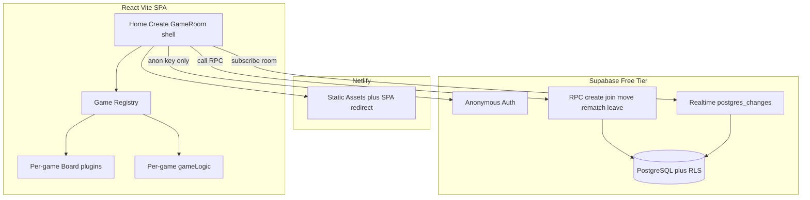
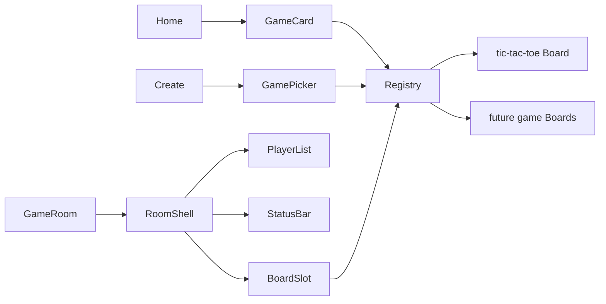

# Game Night — Low-Cost Multiplayer Mini-Games

Build from an empty repo at `d:\new\game-connect` as a Vite + React + TypeScript SPA, with Supabase as the only backend and Netlify for static hosting.

## Architecture



**Server authority:** all mutations go through Postgres RPCs (`SECURITY DEFINER` with explicit checks). Clients never write `board`, `winner`, `current_turn`, or `status` directly. Frontend only holds `VITE_SUPABASE_URL` + `VITE_SUPABASE_ANON_KEY`.

**Identity:** Supabase anonymous sign-in on first visit; persist `auth.uid()` via the Supabase session (localStorage). Also persist nickname and last `room_code` in localStorage so refresh reattaches to the same seat.

**UI principle:** pages own the *room*; the registry owns the *game*. New games only add a registry plugin + SQL move branch.

## Stack and scaffolding

- `npm create vite@latest` — React + TypeScript
- Tailwind CSS v4 (or v3 if Vite template prefers) + React Router v6
- `@supabase/supabase-js`
- Vitest for unit tests (game logic)
- `netlify.toml` with SPA fallback: `/* → /index.html` status 200
- `.env.example` with `VITE_SUPABASE_URL` / `VITE_SUPABASE_ANON_KEY`
- No Redis, Docker, dedicated API, or service-role key in the client

## Database (Supabase migrations)

One migration under [`supabase/migrations/`](supabase/migrations/) defining:

**`games`**
- `id` UUID PK, `room_code` text UNIQUE (e.g. `A7K92P` — alphabet without `O/0/I/1`)
- `game_type` text (`tic-tac-toe`)
- `status` text: `waiting` | `active` | `finished` | `abandoned`
- `board` jsonb (opaque per `game_type`; TTT = 9-cell array)
- `current_turn` text (seat symbol for that game)
- `winner` text nullable (seat symbol or `draw`)
- `rematch_requests` jsonb (map of seat/player → bool) — not TTT-specific column names
- `created_at` / `updated_at`

**`game_players`**
- `id` UUID PK, `game_id` FK → games, `player_id` UUID (= `auth.uid()`)
- `nickname` text, `symbol` text (seat id for that game)
- `joined_at`, `last_seen_at`
- UNIQUE(`game_id`, `player_id`), UNIQUE(`game_id`, `symbol`)

**RPCs (authoritative):**
| Function | Behavior |
|---|---|
| `create_game(game_type, nickname)` | Auth required; insert game using that type’s initial board; host = first seat; return room |
| `join_game(room_code, nickname)` | Validate waiting + player count &lt; max for type; insert next seat; set `active` when full enough to start |
| `make_move(room_code, move jsonb)` | Dispatch by `game_type`; validate membership, active, turn, legal move; update board/winner/turn |
| `request_rematch(room_code)` | Set caller’s rematch flag; if all seated players agree, reset board/turn/winner/status/flags |
| `leave_game(room_code)` | Remove/mark player; set `abandoned` or notify peer |
| `heartbeat(room_code)` | Update `last_seen_at` for presence |

Move validation for Tic-Tac-Toe is implemented in SQL (mirror of TS `gameLogic`) so the DB is authoritative; future games add a branch (or helper function) per `game_type`. Shared pure TS logic is for tests and optional client hints only — final state always comes from Realtime/DB.

**RLS:** SELECT for players in the room (and optionally by `room_code` for join preview). Deny direct INSERT/UPDATE/DELETE on `games` / `game_players` from the client; only RPCs mutate. Enable Realtime on both tables.

**Presence:** client heartbeat every ~15s; if opponent `last_seen_at` stale (~45–60s) show “Reconnecting…” then “Alex left the game” after a longer grace (~2–3 min), without destroying the room on brief blips. Explicit `leave_game` shows leave immediately.

## Extensible game layer (logic + UI plugin)

Every game is a **plugin** registered once. Room chrome never imports Tic-Tac-Toe (or future games) by name.

[`src/games/types.ts`](src/games/types.ts) — `GameDefinition` includes both rules and UI:

**Catalog / create metadata**
- `id`, `name`, `description`, `tagline` (e.g. “Quick game”)
- `minPlayers`, `maxPlayers`
- `status`: `available` | `coming_soon`
- `accent` / `icon` (for GameCard styling without hardcoding per page)

**Rules**
- `initialState()`, `validateMove`, `applyMove`, `getWinner`, `isFinished`
- Seat labels via `seatSymbols` / `getSeatLabel(seat)` (Tic-Tac-Toe: `X`/`O`; later games can use `P1`/`Red`/etc.)

**UI slot (required for available games)**
- `Board`: React component receiving a shared `GameBoardProps` contract:
  - `state` (json from DB), `yourSeat`, `currentTurn`, `winner`, `status`
  - `isMyTurn`, `disabled`
  - `onMove(payload)` — game-specific move shape (position for TTT; column for Connect Four later)
  - `players` nicknames for status copy

[`src/games/registry.ts`](src/games/registry.ts) — `getGame(id)`, `listGames()`, `listAvailableGames()`. Home and Create **only** read from the registry. Coming-soon entries appear disabled with “Coming soon”.

Per-game package layout (add a folder per game later):

```
src/games/
  types.ts
  registry.ts
  tic-tac-toe/
    index.ts          # exports GameDefinition
    gameLogic.ts
    types.ts
    Board.tsx         # Cell + board + win highlight live here
    GameStatus.tsx    # optional game-specific status copy
```

Adding Connect Four later = new folder + one `registry.register(...)` line + SQL branch in `make_move` / `create_game` — **no** Home/Create/GameRoom rewrite.

## Multi-game UI architecture



**Shared room shell** ([`pages/GameRoom.tsx`](src/pages/GameRoom.tsx) + [`components/room/`](src/components/room/)) is game-agnostic:
- Top: brand + **dynamic game name** from registry (`game.name`)
- Players panel: seats from `game.maxPlayers` / joined players; “You” badge; presence; seat label from definition (not hardcoded “X/O” in the shell)
- Center: **Board slot** — `const def = getGame(game.game_type); return <def.Board ... />`
- Status strip: generic turn/result helpers (`Your turn` / `{nickname}'s turn` / win/lose/draw) driven by seat + nicknames; games may override via optional `renderStatus`
- Bottom actions always the same: Copy Invite, Leave, Rematch (when finished)

**Home**
- Hero: Game Night + tagline + Create / Join
- **Games catalog** section: map `listGames()` → `GameCard` (available vs coming soon). Scales as games are added; no hard-coded single card.

**Create flow**
1. Nickname
2. **Game picker grid** from `listAvailableGames()` (selectable cards; coming-soon visible but not selectable)
3. Create → ready screen shows selected game name + room code + share link + waiting

**Join** stays game-agnostic (room already has `game_type`); after join, GameRoom resolves the Board from registry.

**Empty / unknown game_type:** GameRoom shows a friendly “This game isn’t supported in this version” + Back Home (forward-compatible if an old client hits a new game).

## Routes and UX flows

| Route | Purpose |
|---|---|
| `/` | Landing: brand **Game Night**, tagline, Create / Join, **registry game catalog** |
| `/create` | Nickname → **pick any available game** → create → share link + waiting |
| `/join/:roomId?` | Manual join: enter code (if missing) + nickname → redirect to game |
| `/game/:roomId` | Seat / play / rematch / leave / errors — Board from registry |
| `*` → NotFound | Friendly 404 |

**Create:** host takes first seat (TTT = X); show room code + copyable `https://<host>/game/<code>`; “Waiting for your friend…”.

**Join via shared URL:** `/game/:roomId` — if not seated and slot free → nickname → `join_game` → second seat. Full → “This game already has two players.” (copy later generalizes to “room is full” using `maxPlayers`). Missing → “Game not found”. Both seated → auto-start (`status=active`).

**Connection banner:** Realtime channel status → “Reconnecting…” / “Connected”; on restore, refetch game + players.

## Key frontend modules

- [`src/lib/supabase.ts`](src/lib/supabase.ts) — client singleton
- [`src/services/gameService.ts`](src/services/gameService.ts) — RPC wrappers (pass `game_type`; move payload opaque jsonb)
- [`src/hooks/usePlayer.ts`](src/hooks/usePlayer.ts) — anon auth + local nickname
- [`src/hooks/useGameRoom.ts`](src/hooks/useGameRoom.ts) — load room, actions, leave
- [`src/hooks/useRealtimeGame.ts`](src/hooks/useRealtimeGame.ts) — single subscription per `game_id`, cleanup on unmount, reconnect refetch
- **Shared / room UI:** `Button`, `GameCard`, `GamePicker`, `PlayerBadge`, `PlayerList`, `RoomHeader`, `RoomActions`, `LoadingScreen`, `ErrorState`, `ConnectionBanner`
- **Per-game UI only under** `src/games/<id>/` (Board, cells, game-specific animations) — never under pages

**UI direction:** mobile-first indie feel — warm playful palette (avoid purple-glow / cream-terracotta clichés), cards for interactive surfaces (game picker, player list), large tap targets, one job per section. Brand “Game Night” is the hero on `/`. Subtle CSS/Tailwind motion (cell press, win highlight, join, copy feedback) lives mostly in the game Board plugin.

**How to add a game (documented in README):**
1. Add `src/games/<id>/` with `gameLogic`, `Board`, and `GameDefinition`
2. Register in `registry.ts` with `status: 'available'`
3. Extend SQL `create_game` / `make_move` for the new `game_type` (or dispatch table)
4. Ship — Home catalog and Create picker pick it up automatically

## Testing

Vitest covering Tic-Tac-Toe: horizontal/vertical/diagonal X wins, O wins, draw, occupied cell, wrong turn, finished game, sequence of moves, reset. Keep tests under [`src/games/tic-tac-toe/`](src/games/tic-tac-toe/). Future games add their own `*.test.ts` beside their logic.

## Deployment docs

README will cover Supabase setup, env vars, Netlify SPA redirects, plus a short **“Adding a new game”** checklist (registry + Board plugin + SQL branch).

## Implementation order

1. Scaffold Vite/React/TS + Tailwind + Router + Vitest + env example + `netlify.toml`
2. `GameDefinition` + registry + Tic-Tac-Toe logic/Board plugin + unit tests + one coming-soon stub card
3. Supabase migration: schema, RLS, RPCs (move as jsonb + game_type dispatch), Realtime
4. Client lib + services + player/room/realtime hooks
5. Registry-driven Home catalog, Create picker, GameRoom shell + Join/NotFound
6. Rematch, presence/leave, connection status, error states
7. README (deploy + add-a-game); mobile/animation polish on shell + TTT Board
